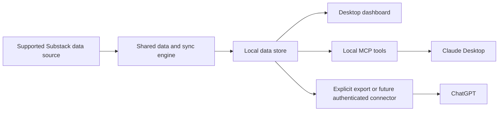

# Desktop app plan: Substack analytics for writers

**Status:** Planning document, not an implementation commitment
**Last reviewed:** November 3, 2026
**Audience:** Writers on macOS or Windows who may use Claude or ChatGPT

## Goal

Turn the current local dashboard into an installable app that keeps a writer's analytics current, explains post and Note performance, and optionally lets an AI assistant explore the same data. A writer should be able to install it, connect a publication, see when data was last refreshed, and use it without a terminal or an AI account.

“Live sync” means scheduled, incremental refresh while the app is running, plus manual refresh. We have no established Substack event feed, so the app must not imply that every number updates instantly.

## Product shape

The desktop app is the primary product. AI access is optional. The dashboard and MCP tools should use the same records, definitions, and freshness information. Cloud hosting is not required for the base app.

## What we can reuse

| Existing part | Reuse in the app | Work needed |
| --- | --- | --- |
| `substack_local/analytics/` | Shared request, normalization, and cache logic | Separate source adapters from presentation; add durable sync state and source provenance. |
| `substack_local/dashboard/` | Current writer-focused views and charts | Put the web UI in a thin desktop shell; add onboarding, connection status, and sync controls. |
| `substack_local/mcp/` | Local MCP tool contracts | Package the runtime and expose deliberate, bounded data queries. |
| `substack-pull` and `substack-notes-pull` | Incremental backup and local search behavior | Extract reusable operations from CLI entry points; retain the CLIs for technical users. |
| `substack/.analytics-cache/` | Short-term request cache | Keep it distinct from durable history; add schema migrations, retention, and a clear-data action. |

Today the project requires macOS, Python, a manually supplied Substack browser session, and Keychain. The dashboard runs on `127.0.0.1`; the MCP server runs over local standard input/output. None is yet a consumer desktop installer or a Windows implementation. See the [current setup](../README.md) and [code map](../substack_local/README.md).

## Mac and Windows design

Use one shared application engine and UI, with small operating-system adapters:

| Concern | macOS | Windows |
| --- | --- | --- |
| Secret storage | Keychain | Windows Credential Manager |
| App data | User application-support directory | User application-data directory |
| Installer and updates | Signed, notarized app | Signed installer and updates |
| Background refresh | User-controlled app/background helper | User-controlled app/background process |

Choose the desktop shell after a packaging test on both systems. The criteria are bundled runtime size, reliable local MCP launch, update/signing workflow, secure-store integration, and support for the existing web dashboard. A thin shell avoids rewriting the analytics views at the outset.

The app should never read a browser's cookie store without a clear user action. Prefer an approved sign-in or data export route. If manual session entry remains in a private prototype, treat it as temporary, keep it in the OS vault, never put it in logs or MCP responses, and offer disconnect/revoke instructions. Microsoft recommends [Credential Manager](https://learn.microsoft.com/en-us/windows/win32/secbp/handling-passwords) for Windows application secrets.

## Sync behavior

1. On first run, explain the available data source and connect or import one publication.
2. Load saved data immediately, showing its age and source while a refresh runs.
3. Refresh publication summaries and changed indexes on a bounded schedule while the app is running; fetch post and Note detail when opened or needed for comparison.
4. Reuse the current 15-minute post-index and one-hour post/Note detail caches as initial limits, then tune them to the source's terms. A cache hit is not a completed new sync.
5. Coalesce duplicate requests, cap concurrency, back off on failures or rate limits, and pause when offline or signed out.
6. Show **Last updated**, **Updating**, **Needs reconnection**, and **Data unavailable** states at the relevant view, with manual **Refresh**.
7. Preserve historical snapshots needed for comparisons separately from disposable request caches. Let users inspect and delete local data.

No background schedule or refresh frequency should be finalized until the data-access route is settled.

## Claude and ChatGPT

| User path | Initial experience | What must be built or checked |
| --- | --- | --- |
| Claude Desktop on Mac or Windows | Optional local MCP extension that queries the installed app's data | Bundle a self-contained `.mcpb`, test on both systems, and keep sensitive settings in OS storage. Claude documents [desktop extensions](https://support.claude.com/en/articles/10949351-getting-started-with-local-mcp-servers-on-claude-desktop) for local MCP servers. |
| ChatGPT, simple path | Explicitly export a concise report or selected CSV from the app for use in ChatGPT | Make the export understandable, bounded, and clear about what data is shared. |
| ChatGPT, connected path | Optional authenticated MCP connector after the product and access model are proven | ChatGPT's [custom MCP server setup](https://developers.openai.com/api/docs/guides/custom-mcp-server) uses a server URL or a tunnel; broad distribution needs supported hosting, authentication, and user isolation. |

A private [Secure MCP Tunnel](https://developers.openai.com/api/docs/guides/secure-mcp-tunnels) can reach a local/private server for testing or permitted users, but OpenAI says it is not a public plugin distribution route. A directly installable local ChatGPT desktop plugin is currently limited to [approved partners](https://developers.openai.com/plugins/deploy/desktop-only). Recheck these paths before implementation because platform capabilities and eligibility can change.

The app should disclose that data returned by an MCP tool or exported to an assistant leaves the local app for that assistant's service. AI integration remains opt-in, and users can disable individual tool access.

## Data-access release gate

The current analytics client uses Substack's authenticated, undocumented network requests. Substack's [Terms of Use](https://substack.com/tos) restrict crawling and scraping, so broad distribution of automatic refresh on those requests requires a deliberate access and policy decision. This is the main release constraint, not the desktop shell.

Investigate these routes in order:

1. **Substack export:** Users can [download posts, subscriber lists, and related statistics](https://support.substack.com/hc/en-us/articles/360037466012-How-do-I-export-my-posts). Confirm exactly which fields and history are present. Import is less live but suitable for a dependable baseline.
2. **Official Substack MCP:** Substack offers a [read-only publication connector](https://support.substack.com/hc/en-us/articles/50834026608916-How-to-connect-Substack-to-your-AI-Assistant) for eligible Bestseller publications. Check whether its terms and tool output permit powering a separate desktop dashboard. It currently excludes profile and Notes activity, which are central to this product.
3. **Approved access for full analytics:** Seek permission or another supported data route for the post and Note insights the official paths omit. Document allowed request volume, permitted storage, and user eligibility before enabling automatic sync for other writers.

If approved access cannot cover Notes, decide openly whether to ship a more limited publication/post product or hold the broader release. Do not market the current Note analysis as universally available.

## Privacy and safety requirements

- Keep each writer's publication data and credentials isolated.
- Keep secrets in OS storage; keep analytics in an app-owned local directory with restrictive permissions and a deletion control.
- Protect any local HTTP interface with a per-install secret or equivalent capability, strict origin/host checks, and a port chosen safely at launch. The current loopback host/origin checks alone are not a consumer-app security boundary.
- Keep MCP answers bounded; avoid returning raw subscriber lists or entire archives by default.
- Allow manual export and AI access independently of background syncing.
- Provide account disconnect, local-data deletion, and diagnostics that omit credentials and private content.

## Build sequence and exit criteria

### 0. Resolve access and scope

- Inventory fields in exports and the official connector against current dashboard features, especially Notes.
- Record the chosen permission/data route and the features it supports.
- **Exit:** A reviewable source matrix and a decision on whether Note analytics can be distributed.

### 1. Prepare the shared engine

- Move Mac-only credential and path behavior behind platform interfaces.
- Separate refresh scheduling, durable snapshots, and short-lived cache reads.
- Make dashboard and MCP responses report source, fetched time, and errors consistently.
- **Exit:** The same local dataset produces the same numbers in the UI and MCP on Mac and Windows test machines.

### 2. Ship a no-code desktop beta

- Package a thin desktop shell and bundled runtime for Mac and Windows.
- Add connect/import, sync status, pause/resume, manual refresh, and clear-data flows.
- Sign installers and verify clean install, upgrade, restart, offline use, and session expiry.
- **Exit:** A writer can install, connect/import, understand freshness, and use the dashboard without a terminal.

### 3. Add optional AI paths

- Package/test a Claude Desktop local extension.
- Add a selective report export for ChatGPT users.
- Prototype a ChatGPT connector only after confirming product access, user isolation, hosting cost, and the current distribution route.
- **Exit:** AI can answer the same basic questions as the dashboard without receiving credentials or unrelated private data.

## Decisions to revisit before implementation

1. Which supported Substack source can provide the full post and Note dataset for other users?
2. Does the first release require automated refresh, or is export import acceptable until access is resolved?
3. Should the app run in the background when closed, or refresh only while open?
4. Which desktop shell passes the two-platform packaging test with the least maintenance?
5. Is a hosted ChatGPT connector valuable enough to justify accounts, cloud operations, and additional data transfer?

The recommended first release is a local Mac/Windows dashboard with a supported data source and clear freshness controls. Add Claude's local MCP path as an optional companion. Treat a broadly distributed ChatGPT connector as a separate product decision.
